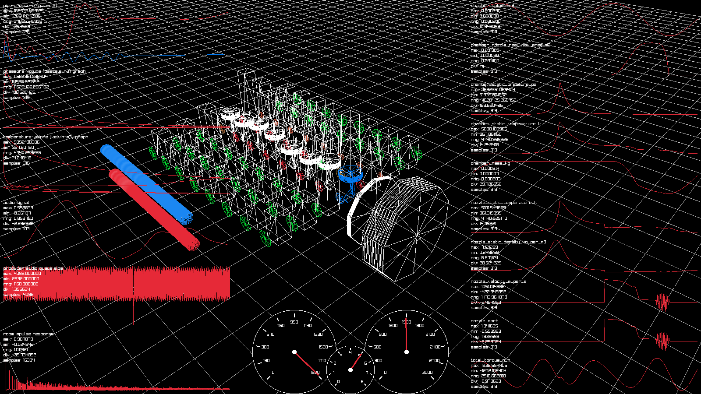

## ENSIM5

Ensim5 is a single threaded, branch free, allocation free, real time internal combustion engine audio DSP with 250Hz input/output control.

[https://www.youtube.com/watch?v=za0bQ6HqPRg](https://www.youtube.com/watch?v=za0bQ6HqPRg)

Ensim5's DPS engine simulates the engine thermofluidic otto-cycle with zero-dimensional isentropic flow
and one-dimensional pipe computational fluid dynamics. Audio, in the form of a static pressure signal,
is sampled from pipe cells and fed into a cubed room with a precomputed room impulse response.

The zero dimensional isentropic model maps natively to SIMD lanes by mapping N flow channels in parallel by
skipping junction nodes (eg. engine plenums and exhaust collectors). Engine audio is approximated by displacing
pipe connection offsets to emulate exhaust pulse arrival time, as heard by variable length or equal length exhaust runners.

## Build

Ensure raylib is installed (`pacman -S raylib`) and a c++20 compliant compiler like clang, then:

`make && ./gui`

## Controls

`1,2,3,4`: Throttle

`0`: Disables ignition

`Q,E`: Camera pan

`W,A,S,D`: Chamber select

`<,>`: Gear decrement/increment

### ATTRIBUTION

Ange Yaghi for the inspiration.
